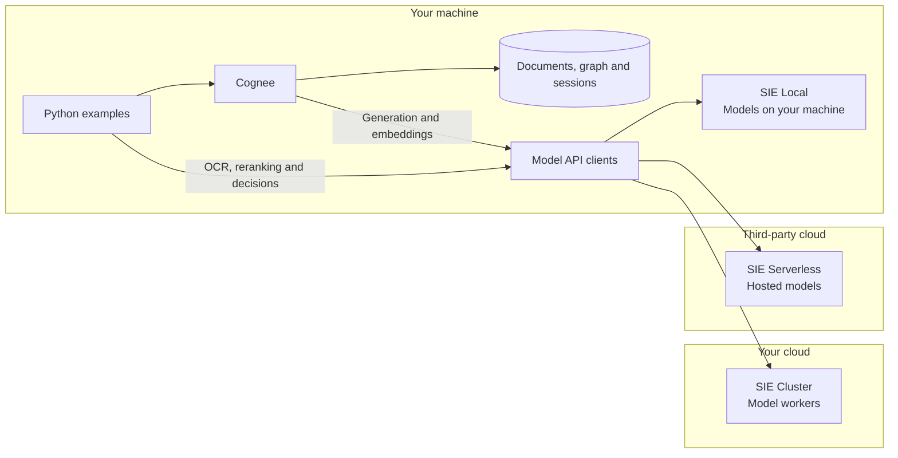
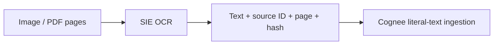
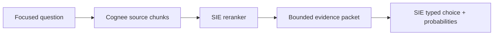
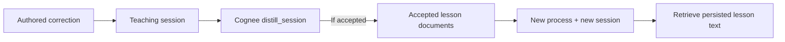

# Memory and model tools with SIE + Cognee

Combine Cognee's persistent document and conversation memory with SIE's models
for generation, embeddings, OCR, reranking and typed decisions. Choose SIE Local,
SIE Cluster or SIE Serverless endpoints for each model role.

These four Python examples show how to store and retrieve records, read a
document, make a decision from source text and teach guidance for a later
conversation. Each saves its inputs and intermediate results for inspection.
For Node.js applications, use the [TypeScript examples](typescript/README.md) and
[TypeScript integration](../../integrations/sie_ts_cognee/README.md). The two
versions use separate Cognee engines and storage directories; the TypeScript
guide describes its supported learning API.

The examples share a fictional workshop notebook: a readiness policy, equipment
checks, a scanned access note and an authored policy correction. The inputs
are [synthetic and CC0](data/README.md), downloaded from a pinned public dataset.
Recommendations never trigger actions.



Cognee stores and searches memory on your machine. SIE Local runs models on
that machine, SIE Cluster runs model workers in your cloud, and SIE Serverless
uses hosted models in a third-party cloud.

The model API clients are Python libraries in the example process. Each role
calls its configured endpoint; different roles can use different deployments.
The three outgoing arrows show those deployment choices.

Cognee calls generation and embedding models through compatible APIs. The OCR,
reranking and decision steps use the SIE Python SDK. See the
[integration configuration](../../integrations/sie_cognee/README.md#configure-before-importing-cognee)
for provider and transport details.

Serverless receives the text, images and evidence sent for inference. Local
memory alone does not keep remote inference inputs on your machine. Fully local
inference requires every model role to run locally.

## Run it

Use Python 3.12 and `uv`, from a checkout of this repository:

```sh
cd examples/cognee
uv sync
uv run fetch.py
cp .env.example .env
```

The lock installs Cognee 1.6.7 and the integration/SDK from their relative paths
in this checkout.

`fetch.py` anonymously downloads six inputs from
[the pinned workshop dataset](https://huggingface.co/datasets/superlinked/sie-task-evidence/tree/487cdc3bd0480659afd7ee88329449e6a6c8655d/cognee/workshop-starter/2026-11-06/v1).
It checks the manifest and every file's size and SHA-256 before using the local,
ignored `data/` copies. No Hugging Face account or API key is needed. Re-running
the fetch verifies cached files; move edited copies elsewhere before restoring
the pinned inputs. The Python standard library is sufficient to run the fetch.

Get an API key from the [Superlinked console](https://console.superlinked.com)
and put it in the ignored `.env` file:

```dotenv
SIE_BASE_URL=https://api.superlinked.com
SIE_API_KEY=<your-key>
SIE_COGNEE_NAMESPACE=example-v1
```

```sh
uv run 01_memory.py --graph
uv run 02_read_documents.py
uv run 03_decide.py
SIE_COGNEE_NAMESPACE=learning-v1 uv run 04_learn.py --seed
```

Each command prints its configuration and saves JSON under
`runs/<namespace>/<timestamp>-<experiment>/`. Cold provisioning and distillation
can take minutes. Configurable budgets are 180 seconds for native provisioning,
90 seconds per native request attempt and 600
seconds per experiment. In-flight work may take longer to unwind on cancellation.

## 1. Remember and retrieve

[`01_memory.py`](01_memory.py) ingests three explicit sources through
`cognee.remember(..., self_improvement=False)`, then retrieves their text with
`SearchType.CHUNKS`.

```python
document = SourceDocument(text=text, source_id="CHECK-01", filename="projector-check.txt")
await cognee.remember(document.to_data_item(), dataset_name=dataset, self_improvement=False)
chunks = await retrieve_chunks(question, dataset=dataset, top_k=5)
```

Inspect `source-chunks.json` for text, chunk IDs and metadata. `--graph` adds
separately labeled, model-derived graph context. Retrieved document text is the
evidence used by the decision step.

**Build on it:** replace the records with versioned policies and checks, then
filter sources by the applicable date.

## 2. Read a document

[`02_read_documents.py`](02_read_documents.py) sends the synthetic access note
through SIE OCR and ingests the returned text with page provenance.

```sh
uv run 02_read_documents.py
uv run 02_read_documents.py path/to/note.pdf
```



Inspect `page-1-actual-ocr.json` beside [the published image](https://huggingface.co/datasets/superlinked/sie-task-evidence/resolve/487cdc3bd0480659afd7ee88329449e6a6c8655d/cognee/workshop-starter/2026-11-06/v1/access-note.png), then
`page-1-provenance.json`. The note says step-free access is not yet confirmed.
Its [authored text](https://huggingface.co/datasets/superlinked/sie-task-evidence/blob/487cdc3bd0480659afd7ee88329449e6a6c8655d/cognee/workshop-starter/2026-11-06/v1/access-note.txt)
is input, not a recorded OCR reply. To render a local variant without replacing
the downloaded PNG:

```sh
uv run make_document.py
uv run 02_read_documents.py runs/access-note-rendered.png
```

Rendering can differ across Pillow versions; use the downloaded image for the
pinned example.

PDF pages are rendered locally and sent separately, with file, page and pixel
limits. Literal ingestion means filenames or URLs in OCR output cannot trigger
new file reads or URL ingestion. This script also runs in an empty namespace.

**Build on it:** add transcription review and retain page crops with reviewed text.

## 3. Retrieve, rerank and decide

[`03_decide.py`](03_decide.py) retrieves document chunks, reranks them through
SIE and sends its top source to a typed decision model. Its focused question is
“Has the projector passed its image check?” with `confirmed`, `failed` and
`unknown` choices.



Run experiment 01 first, or seed this building block independently:

```sh
SIE_COGNEE_NAMESPACE=decision-v1 uv run 03_decide.py --seed
```

Inspect candidates → reranking scores → `decision-exact-packet.json` → outcome.
The evidence map connects short `E1`, `E2` aliases to original chunk IDs.
Questions and criteria live in `config.toml`.

With the supplied records, look for `CHECK-01` as the selected source and
`confirmed` as the projector-check outcome. Probability values can vary.

The default decision model has a 512-token combined context. A character guard
bounds the packet; `overflow_policy=error` preserves the server's exact token
limit. Oversized or absent evidence returns `unknown` without invented
probabilities. Text is never silently truncated. Probabilities describe model
preference and do not establish correctness.

**Build on it:** ask focused questions about each check, then compose their
typed results with a plain Python rule, such as continuing only when every
required check is `confirmed`.

## 4. Learn guidance for a new conversation

[`04_learn.py`](04_learn.py) records an authored correction in a teaching
session and invokes Cognee's public session distillation. After that command
exits, a second invocation verifies the stored lessons in a fresh process:

```sh
SIE_COGNEE_NAMESPACE=learning-v1 uv run 04_learn.py --seed
# Replace TEACHING_RUN with the output directory printed by the first command.
SIE_COGNEE_NAMESPACE=learning-v1 uv run 04_learn.py --verify-run runs/learning-v1/TEACHING_RUN
```

The teaching command prints the exact verification command, including its run
path. Copy that command after teaching finishes. Keep the same namespace and
embedding configuration; verification checks them against the recorded run and
stored memory. `--verify-run` cannot be combined with `--seed`.



The correction adds confirmed step-free access to the readiness policy.
Inspect `authored-correction.json`, the teaching session,
`actual-distillation.json` in the teaching run, then the fresh-session artifacts
in the verification run. Distillation returns its actual status and accepted
lesson texts; only `completed` with documents counts as persisted learning.

The fresh session asks whether a new workshop with working equipment still
needs access confirmation. Set this question in `[learning]` in `config.toml`.
Use fresh memory so an earlier OCR note or lesson does not supply the answer
before teaching. Verification disables automatic feedback and does not ingest,
teach or distill. Its new process and session have not received the correction.

Inspect `fresh-session-retrieved-documents.json` and `learning-evidence.json`:
the latter matches complete accepted lesson text to retrieved chunks, ignoring
whitespace. A heading alone does not establish that a document is the accepted
lesson. Generated answers remain separate, and retrieved model-generated lessons
still need checking against the authored correction. Empty results stay visible.

Fresh-process retrieval verifies persisted text, not the truth or completeness
of the learned policy. Generated answers remain model output and require their
own review.

**Build on it:** require human approval of learned guidance, then feed selected
guidance into the typed decision building block from experiment 03.

## Change models or inference location

| Role | Default model |
| --- | --- |
| Structured LLM | `Qwen/Qwen3.5-4B` |
| Embeddings | `BAAI/bge-m3`, 1024 dimensions |
| OCR | `lightonai/LightOnOCR-2-1B` |
| Reranking | `Qwen/Qwen3-Reranker-0.6B` |
| Decision | `fastino/GLiNER2.5-Decide` |

`config.toml` holds models, criteria, retrieval sizes and budgets. Optional
`SIE_<ROLE>_MODEL` variables override `LLM`, `EMBEDDING`, `OCR`, `RERANK` or
`DECISION`; `SIE_EMBEDDING_DIMENSIONS` overrides dimensions. For example:

```sh
SIE_LLM_MODEL=Qwen/Qwen3.8-27B-FP8 SIE_COGNEE_NAMESPACE=another-llm uv run 01_memory.py
```

To serve this override on your own NVIDIA GPU, use the
[CUDA 13 generation alternative](LOCAL.md#cuda-13-alternative).

[`.env.example`](.env.example) shows separate URLs and keys for each role.
Compatible LLM/embedding endpoints append `/v1` once. A role inherits the
general API key only when its endpoint shares the general endpoint's origin.

For **SIE Local or SIE Cluster**, follow [LOCAL.md](LOCAL.md): Linux CPU
embedding/reranking, Apple Silicon MLX generation, GPU bundles and endpoint
settings. Check that your hardware supports the selected models and has enough
memory to run them.

## State and offline checks

Each namespace owns `.state/<namespace>/cognee` and dataset `sie-<namespace>`.
Use a new namespace when changing embeddings or starting a clean learning
exercise. Do not run two scripts against one namespace simultaneously.

Inspect or remove only this example's saved state and results from this folder, after
stopping scripts that use it:

```sh
find .state/learning-v1 runs/learning-v1 -maxdepth 2 -type f
rm -rf -- .state/learning-v1 runs/learning-v1
```

Offline checks use hand-authored stand-ins, need no downloaded inputs and make
no network or inference calls:

```sh
uv run pytest -q
uv run ruff check . --select E,F,I,UP,B
uv run ruff format --check .
uv run ty check common.py fetch.py 01_memory.py 02_read_documents.py 03_decide.py 04_learn.py make_document.py
```
