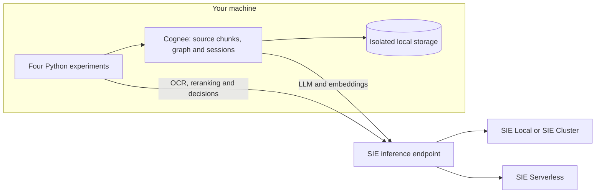
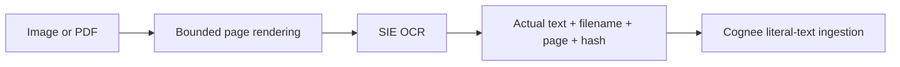
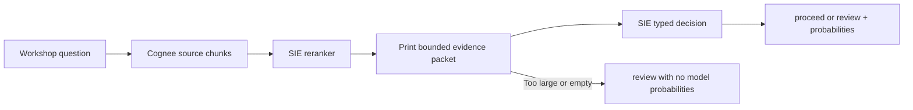
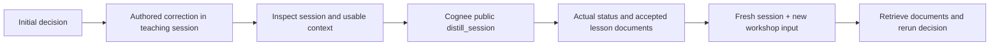

# Memory that you can inspect: four SIE + Cognee experiments

A workshop organizer has three small records: a readiness policy, a projector
check and a microphone check. A scanned note adds an unresolved access check.
Can we remember the records, read the note, make a bounded recommendation and
carry an explicit policy correction into a new conversation?

These are four technical experiments for a ten-minute presentation. They are
composable Python scripts, not an autonomous organizer. All records are
[synthetic, CC0 1.0](data/README.md); recommendations never trigger actions.

**SIE** runs specialized models through one API using SIE Local, SIE Cluster
or SIE Serverless: LLMs, embeddings, OCR, rerankers and decision models.
**Cognee** turns documents and interactions into persistent, retrievable memory.
Here Cognee 1.6.7 stores its databases on your machine and calls SIE for inference.



Storage location and inference location are separate choices. With Serverless,
document text, images, queries and retrieved evidence are sent to the configured
remote inference endpoints. A local database alone does not provide local
inference or confidential cloud execution. For local-only inference, every role
below needs a locally served model.

## Run from the source checkout

This starter uses the checked-out integration and SDK; it does not assume that
`sie-cognee` is already published. Clone this repository at a revision containing
`integrations/sie_cognee`, then, with Python 3.12 and `uv` installed:

```sh
cd examples/cognee
uv sync --locked
cp .env.example .env
```

Create an API key in the [Superlinked console](https://console.superlinked.com).
Check the console for available starter credits and request access/approval if
required; this example does not promise a credit amount or automatic approval.
Set these values in the ignored `.env` file:

```dotenv
SIE_BASE_URL=https://api.superlinked.com
SIE_API_KEY=<your-key>
WORKSHOP_NAMESPACE=workshop-v1
```

`config.toml` holds models, dimensions, top-k, input budgets, timeouts and decision
criteria. Environment variables hold endpoint addresses and keys. Each role can
have its own endpoint and key, as shown in `.env.example`. A role inherits the
general key only when its endpoint has the same origin. The compatible LLM and
embedding routes append `/v1` once; native OCR, rerank and decision endpoints use
the SIE base URL. Keys are never included in example artifacts.

Optional `SIE_LLM_MODEL`, `SIE_EMBEDDING_MODEL`, `SIE_OCR_MODEL`,
`SIE_RERANK_MODEL` and `SIE_DECISION_MODEL` override the model table.
`SIE_EMBEDDING_DIMENSIONS` overrides dimensions. For example, to test a stronger
hosted LLM in a fresh learning experiment:

```sh
SIE_LLM_MODEL=Qwen/Qwen3.8-27B-FP8 WORKSHOP_NAMESPACE=learning-27b uv run 04_learn.py --seed
```

This is a model comparison to run, not a claim that its lessons will pass.

| Role | Default | Purpose |
| --- | --- | --- |
| Structured LLM | `Qwen/Qwen3.5-4B` | Cognee extraction, answers and session distillation |
| Embeddings | `BAAI/bge-m3`, 1024 dimensions | Store and retrieve text chunks |
| OCR | `lightonai/LightOnOCR-2-1B` | Turn a page image into literal text |
| Reranking | `Qwen/Qwen3-Reranker-0.6B` | Reorder retrieved chunks for the question |
| Decision | `fastino/GLiNER2.5-Decide` | Choose `proceed` or `review` with probabilities |

Cold models can take minutes to provision. Rehearse each command before a talk.
The native calls have a 180-second provisioning budget, requests have a
90-second per-attempt budget, and each experiment has a 600-second asynchronous
budget. Cognee can perform several LLM calls; cancellation and in-flight native
threads can take additional time to unwind. A timeout records a failure, never
a guessed result. Adjust budgets deliberately in `config.toml`.

## 1. Remember facts, then inspect what was remembered

```sh
uv run 01_memory.py
uv run 01_memory.py --graph
```

The first script uses `cognee.remember(..., self_improvement=False)` for three
short, authored sources: `POLICY-01`, `CHECK-01` and `CHECK-02`. It uses explicit
`SearchType.CHUNKS` retrieval to show actual document text, chunk IDs and
metadata. `--graph` additionally prints the assembled, model-derived context
under a separate label. It is not used as decision evidence.

**Look at:** `source-chunks.json`, then the separately labeled graph artifact.
Source text and graph assertions need not agree. An exploratory remote run with
the smaller LLM turned a source saying only “Saturday” into a graph assertion
with an invented June 2024 date. The supplied fixtures use explicit dates, but
that does not establish extraction correctness. Inspect every generated claim.

**Extend it:** add a second dated policy and make policy version selection
explicit before retrieving evidence.

## 2. Read a document without losing its page

```sh
uv run 02_read_documents.py
# Or provide a small image/PDF that you are authorized to send to your endpoint:
uv run 02_read_documents.py path/to/note.pdf
```



The committed PNG renders `data/access-note.txt`: step-free access is **not yet
confirmed**. The text file is authored input, not an OCR recording. You can
regenerate the image with `uv run make_document.py`; rendering does not use a
model. PDF pages are rasterized locally and sent separately. Size, page count
and pixel limits fail explicitly rather than silently dropping pages.

**Look at:** each `page-N-actual-ocr.json` and `page-N-provenance.json`. OCR text
is ingested as literal text, so a filename or URL in the result cannot trigger
file reads or URL ingestion. Provenance contains the basename, page, stable
source ID and content hash. OCR text is model output and still needs checking
against its page. This script can run independently in an empty namespace.

**Extend it:** keep a review queue for uncertain OCR lines and retain page crops
alongside reviewed transcriptions.

## 3. Retrieve, rerank, then recommend

```sh
uv run 03_decide.py
# Independent rehearsal: ingest the initial records first.
WORKSHOP_NAMESPACE=decision-rehearsal uv run 03_decide.py --seed
```



Run experiment 01 first, or use `--seed`. Experiment 02 adds another candidate
document but is optional. The script shows every retrieved candidate, reranking
score and selected chunk. Short `E1`, `E2` aliases map back to the original IDs
in `decision-evidence-map.json`. `decision-exact-packet.json` is exactly the
text sent to the decision model; criteria remain visible in `config.toml`.

The initial policy requires projector and microphone checks. This is deliberately
incomplete: equipment readiness does not establish that everyone can attend.
The next experiment supplies an authored correction. Inspect which policy and
checks actually reach the model; top-k retrieval can omit required evidence.

The default decision model has a **512-token combined context**. The character
guard is not an exact tokenizer estimate and excludes schema overhead. The
request uses `overflow_policy=error`; server overflow remains an error. Oversized
client evidence returns an explicit `review` without model probabilities.
Nothing truncates source text. Reduce top-k or use a model with a suitable
context window if the packet does not fit.

**Look at:** candidates → ranks → packet → probabilities. Probabilities express
model preference, not correctness or calibrated confidence. `review` is an
explicit choice; no output authorizes a real workshop to proceed.

**Extend it:** require coverage of each policy requirement before allowing a
recommendation to reach a human reviewer.

## 4. Correct, distill, and ask in a new session

```sh
# Fresh namespace avoids lessons from an earlier rehearsal.
WORKSHOP_NAMESPACE=learning-rehearsal uv run 04_learn.py --seed
```



The authored correction says every workshop also requires confirmed step-free
access. It enters a named teaching session through `recall`, with
`AUTO_FEEDBACK=true`, `CACHING=true` and sequential session processing configured
before Cognee imports. The script inspects that session and its usable context,
then calls the public `cognee.session.distill_session`. It does not equate a
friendly generated acknowledgment or an `add_feedback` call with learning.

`actual-distillation.json` contains the returned status and the actual accepted
lesson texts. `no_gated_entries`, `no_new_entries`, `no_proposed_lessons` and
`no_accepted_lessons` are meaningful outcomes. Only `completed` with documents
is counted as persisted learning. The public session-context view shows usable
entries; the distillation status is authoritative about its own gating and
acceptance. An exception stops the experiment with a failure artifact.

The next question concerns a different workshop on **2026-11-21**, with working
equipment and unconfirmed access. It uses a new session ID that never received
the correction. The generated fresh-session answer is displayed separately;
the decision still retrieves document chunks. A persisted session lesson is
model-generated policy text, visibly headed `Session learning`, and must be
checked against `authored-correction.json`. It is not independent evidence that
an access check passed. No lesson, an omitted lesson, or an unchanged decision
is reported as such. Because the input changes, this is a transfer experiment,
not a causal evaluation of improvement.

**Look at:** teaching session → usable context → actual distillation documents
→ fresh session → after-decision evidence → comparison. Distillation can make
many remote calls and can exceed the demo time budget; an accepted answer is
not a saved lesson.

**Extend it:** require human approval of a proposed lesson and test it on new
authored cases before treating it as policy.

## A ten-minute presentation

| Time | Show | Point to make |
| --- | --- | --- |
| 0–1 min | Deployment diagram and config | Memory location and inference location are independent |
| 1–3 min | Experiment 01 source and graph artifacts | Persistent memory can contain both evidence and generated claims |
| 3–5 min | Experiment 02 image, OCR and page metadata | Inspect the transformation before trusting the result |
| 5–7 min | Experiment 03 candidates, ranks, packet and probabilities | Specialized models compose; budgets and review are explicit |
| 7–9 min | Experiment 04 session, returned status and lesson documents | Learning must survive a new session, and can fail |
| 9–10 min | Extensions and endpoint table | Participants can change one role or one policy at a time |

Run the experiments in advance and keep their locally generated artifacts open.
Rehearsal output is not committed, and a presentation should identify it as a
prior live run. Cold provisioning or distillation can exceed a ten-minute slot.

## SIE Local and SIE Cluster

These commands follow the repository's [server setup](../../README.md#quickstart)
and [model catalog](../../packages/sie_server/models). They have **not** been
executed for this starter. Development used a CPU-only machine with about
30 GiB RAM, while inference ran remotely using SIE Serverless. Do not assume
every role fits or runs acceptably on that machine or an arbitrary laptop.

On Linux CPU, start the default bundle for supported embedding/reranking models:

```sh
docker run -p 127.0.0.1:8080:8080 \
  -v sie-hf-cache:/app/.cache/huggingface \
  ghcr.io/superlinked/sie-server:latest-cpu-default
```

On Apple Silicon, embedding/reranking and MLX generation use separate Python
environments and ports because their dependencies differ:

```sh
uvx --from 'sie-server[local]' sie-server serve -p 8080
# Separate terminal/environment; the catalog supplies the MLX model mapping.
uvx --with 'mlx-lm>=0.30.7' --from sie-server sie-server serve -b sglang -p 8081
```

MLX generation requires Apple Silicon and sufficient unified memory. Verify the
selected model's structured JSON support before attempting Cognee ingestion.
This path covers memory LLM/embeddings; it does not establish local OCR or
decision-model availability. On Linux NVIDIA GPU, use a separate bundle for each
incompatible runtime, following the root README's Docker commands:

| Role | GPU bundle/image suffix | Example port |
| --- | --- | --- |
| Embeddings and reranking | `latest-cuda12-default` | 8080 |
| Structured generation | `latest-cuda12-sglang` | 8081 |
| Default OCR profile | `latest-cuda12-sglang-vision-extract` | 8082 |
| GLiNER2.5-Decide | `latest-cuda12-transformers5` | 8083 |

Expose the corresponding container port with, for example,
`-p 127.0.0.1:8082:8080`. Several models on one GPU may not fit at once. Rehearse
with the actual hardware, or use SIE Cluster to route to suitable workers.
Do not substitute the default CPU bundle for the generation or OCR bundle.

After serving the chosen roles locally, use this endpoint mapping and remove
the Serverless key from that shell/`.env`:

```dotenv
SIE_BASE_URL=http://localhost:8080
SIE_API_KEY=
SIE_EMBEDDING_BASE_URL=http://localhost:8080
SIE_RERANK_BASE_URL=http://localhost:8080
SIE_LLM_BASE_URL=http://localhost:8081
SIE_OCR_BASE_URL=http://localhost:8082
SIE_DECISION_BASE_URL=http://localhost:8083
WORKSHOP_NAMESPACE=local-workshop-v1
```

Unauthenticated loopback compatible clients receive a harmless placeholder key;
authenticated endpoints need their actual role-specific keys. For SIE Cluster,
set the base URL to its gateway and explicitly supply keys as appropriate.
Mixing local and remote roles is supported and must be described as mixed
inference, not fully local execution.

## State, inspection and checks

Each namespace owns `.state/<namespace>/cognee` and a `sie-<namespace>` dataset.
Run artifacts live in `runs/<namespace>/<timestamp>-<experiment>/`. The helper
configures isolated SQLite, Ladybug and LanceDB paths. It never clears a user's
global Cognee state. Do not run two scripts against the same namespace at once.
Change namespace before changing embedding model/dimensions; a mismatch is
rejected. Repeated learning runs in one namespace can change future results.

Inspect or delete only the example-owned rehearsal state, from this folder:

```sh
find .state/learning-rehearsal runs/learning-rehearsal -maxdepth 2 -type f
# Stop all scripts using this namespace before deleting it.
rm -rf -- .state/learning-rehearsal runs/learning-rehearsal
```

The offline checks use small hand-authored stand-ins, not recorded model replies:

```sh
uv run pytest -q
uv run ruff check . --select E,F,I,UP,B
uv run ruff format --check .
uv run ty check common.py 01_memory.py 02_read_documents.py 03_decide.py 04_learn.py make_document.py
```

Remote exploratory checks on 2026-11-06 confirmed compatible Cognee memory with
Qwen3.5-4B and BGE-M3, native Qwen3 reranking, LightOnOCR page text, and a native
GLiNER2.5-Decide choice response. The decision model initially exceeded a
320-second provisioning wait before a later call succeeded. These isolated
checks do not claim that every numbered experiment or learning outcome passed;
inspect the actual artifacts from your own run. In an exploratory learning run,
Qwen3.5-4B recognized the correction but returned an invalid distillation field
(`member_entry_ids: null`), so no lesson was persisted. A subsequent
Qwen3.8-27B-FP8 distillation attempt on that session returned
`no_proposed_lessons`. Neither result proves successful learning. No local model
inference was used in development.
